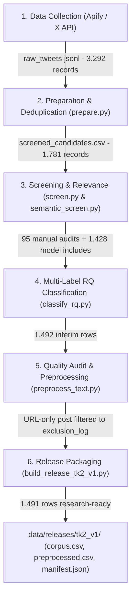

# ANMEDSOS: Keresahan Ketenagakerjaan dan Aspirasi Bekerja ke Luar Negeri di Era #KaburAjaDulu

**Mata Kuliah:** CSIE604284 Analitika Media Sosial (Semester Gasal 2026/2027)  
**Program Studi:** Sistem Informasi / Ilmu Komputer, Fakultas Ilmu Komputer, Universitas Indonesia  
**Tim Peneliti (Authors):** Regina Meilani Aruan, Joshua Hans Vitho Soehendra, Anggun Sasmitha Dewi, Salomo Immanuel Putra  
**Repositori GitHub:** [rerearuan/kaburajadulu-analitik](https://github.com/rerearuan/kaburajadulu-analitik.git)  
**Batasan Temporal:** 1 Januari 2026 – 25 Oktober 2026 (Zona Waktu: `Asia/Jakarta` / WIB)  
**Cakupan Tanggal Riil Korpus Riset:** 1 Januari 2026 – 7 Oktober 2026 (WIB)  
**Status Evaluasi:** `PASS (46/46 Automated Unit & Integration Tests Passing)`

---

## 1. Ringkasan Eksekutif & Artefak Rilis

Repositori ini memuat implementasi lengkap, dapat diaudit, dan dapat direproduksi secara deterministik (100% offline) untuk **End-to-End Data Collection & Preprocessing Pipeline** wacana keresahan ketenagakerjaan dan aspirasi bekerja ke luar negeri di platform X.

### Rilis Dataset Final (TK-2 Release v1)
Keluaran bersih resmi yang telah divalidasi dan direkonsiliasi tersimpan pada folder [`data/releases/tk2_v1/`](data/releases/tk2_v1/):
- **`corpus.csv` (1.491 postingan):** Korpus riset final bebas dari duplikasi dan teks kosong, lengkap dengan metadata query, provenance, dan multi-label Research Questions (RQ1–RQ2).
- **`preprocessed.csv` (1.491 postingan):** Representasi teks pra-pemrosesan yang dinormalisasi (Unicode NFC, pembersihan URL/mention, unescape HTML, dan pemetaan kamus slang resmi 16 pasangan kata).
- **`exclusion_log.csv` (1 postingan):** Catatan pengeluaran postingan URL-only (`post_id: 2030131219137278032`) yang menghasilkan teks kosong setelah pra-pemrosesan.
- **`manifest.json`:** Metadata rilis lengkap yang mencatat source hashes (SHA-256), git commit hash, sebaran statistik RQ, dan status validasi provisional.

---

## 2. Struktur Repositori

```text
ANMEDSOS/
├── README.md                          # Panduan lengkap, metodologi, dan instruksi reproduksi
├── requirements.txt                   # Dependensi Python lengkap (requests, torch, transformers, docx, pytest)
├── pytest.ini                         # Konfigurasi eksekusi pytest mandiri (pythonpath = .)
├── .gitignore                         # Konfigurasi proteksi data privasi & terms platform X
├── .env.example                       # Template environment variable lokal
│
├── config/                            # Konfigurasi & Schema Kamus Penelitian
│   ├── settings.py                    # Konstanta direktori, zona waktu Asia/Jakarta, batas tanggal
│   ├── rq_label_schema.json           # Taksonomi label RQ1, RQ2 (Personal/Public), dan Link
│   ├── screening_config.json          # Ambang batas relevansi semantik & kamus leksikal
│   └── slang_dictionary.json         # Kamus formalisasi 16 pasangan kata slang & singkatan kerja
│
├── src/                               # Modul Pipeline End-to-End (Python 3.9+)
│   ├── collect.py                     # Orkestrator pengumpulan data Apify/X (offline default)
│   ├── prepare.py                     # Ekstraksi temporal WIB & deduplikasi multi-query
│   ├── screen.py                      # Penyaringan heuristik & integrasi audit manual
│   ├── semantic_screen.py             # Klasifikasi semantik leksikal-diskursus lokal
│   ├── classify_rq.py                 # Multi-label classifier untuk RQ1 dan RQ2
│   ├── export.py                      # Modul ekspor format CSV terstandarisasi
│   ├── preprocess_text.py             # Normalisasi Unicode, unescape HTML, slang, & mitigasi pemotongan
│   ├── quality_report.py              # Generator laporan kualitas & matriks rekonsiliasi
│   ├── evaluate_screening.py          # Generator sampel evaluasi terstratifikasi (150 sampel)
│   ├── automated_model_evaluator.py   # Evaluasi model NLI independen (mDeBERTa-v3-base-xnli)
│   ├── generate_docx_report.py        # Generator dokumen resmi laporan akademik DOCX
│   └── build_release_tk2_v1.py        # Release builder otomatis untuk rilis tk2_v1
│
├── scripts/                           # Skrip Utilitas & Audit Historis
│   └── collect_feb_oct_audit.py       # Skrip audit historis distribusi sampling bulanan (Feb–Okt 2026)
│
├── data/
│   ├── sample/                        # Data Sampel Terpseudonimisasi (Tersedia di Repositori)
│   │   └── sample_raw_tweets.jsonl    # 50 baris cuitan sampel untuk uji reproduksi instan penilai
│   ├── interim/
│   │   └── manual_labels.csv          # 95 label ground truth manual manusia (tersedia di git)
│   └── releases/
│       └── tk2_v1/                    # Paket Rilis Korpus Riset Bersih
│           ├── corpus.csv             # 1.491 baris korpus riset bersih
│           ├── preprocessed.csv       # 1.491 baris teks pra-pemrosesan multi-representasi
│           ├── exclusion_log.csv      # Log cuitan non-teks URL-only yang disisihkan
│           └── manifest.json          # Hash integritas SHA-256 & provenance rilis
│
├── docs/                              # Dokumen Laporan & Metodologi
│   ├── Laporan_TK2_ANMEDSOS.docx      # Naskah lengkap laporan akademik TK-2 (format Word)
│   ├── Laporan_TK2_ANMEDSOS.md        # Naskah lengkap laporan akademik TK-2 (format Markdown)
│   ├── relevance_codebook.md          # Definisi inklusi/eksklusi & panduan anotasi RQ
│   └── preprocessing_methodology.md   # Spesifikasi pra-pemrosesan & representasi teks
│
├── reports/                           # Laporan Kualitas, Rekonsiliasi & Audit Mesin
│   ├── tk2_submission_audit.md        # Laporan induk audit & rekonsiliasi row-level
│   ├── automated_model_evaluation_report.md   # Laporan evaluasi AI Judge mDeBERTa & Kappa Paradox
│   ├── automated_model_evaluation_report.json # Laporan metrik AI Judge mesin (JSON)
│   ├── quality_report.md & .json      # Ringkasan kualitas data & verifikasi pipeline
│   ├── rq_coverage_report.json        # Sebaran multi-label RQ pada korpus terpilih
│   └── coverage_report.json           # Audit temporal coverage multi-populasi
│
├── tests/                             # Rangkaian Tes Otomatis (46 Tes Lulus 100%)
│   ├── test_integrity.py              # Tes immutabilitas data mentah & keunikan ID
│   ├── test_screening.py              # Tes filter heuristik & pengecualian noise
│   ├── test_semantic_screen.py        # Tes proteksi keputusan manual & skema klasifikasi
│   ├── test_preprocessing.py          # Tes normalisasi teks, slang, emoji, dan negasi
│   ├── test_rq_classification.py      # Tes pemetaan RQ1 & RQ2
│   ├── test_automated_evaluator.py    # Tes modul evaluator independen AI
│   └── test_release_tk2_v1.py         # Tes integritas berkas rilis tk2_v1 & manifest
│
└── examples/
    ├── run_offline_pipeline.sh        # Shell script eksekusi seluruh pipeline offline (dengan auto-fallback sample)
    └── inspect_data.py                # Skrip inspeksi cepat dataset
```

---

## 3. Alur Pipeline End-to-End

Pipeline data ANMEDSOS beroperasi secara sekuensial dan terisolasi:



1. **Data Collection (`src/collect.py`):** Pengumpulan cuitan publik menggunakan scraper X/Twitter terkelola Apify berdasarkan 36 kata kunci tematik (Grup A–D). Pemantauan run dilakukan dengan interval polling 5 detik hingga 120 iterasi dan kegagalan dicatat transparan ke run log.
2. **Preparation & Deduplication (`src/prepare.py`):** Penguraian timestamp ke zona waktu `Asia/Jakarta` (WIB), validasi jendela temporal half-open (`< 2026-10-08`), dan deduplikasi berbasis `post_id` unik (menghasilkan 1.781 kandidat unik).
3. **Screening & Relevance (`src/screen.py` & `src/semantic_screen.py`):**
   - Integrasi 95 label ground truth manual manusia (64 inklusi, 31 eksklusi) pada `data/interim/manual_labels.csv`.
   - Klasifikasi semantik aturan leksikal-diskursus lokal (`anmedsos-rule-hybrid-v1`) yang memfilter promosi komersial, berita olahraga, dan penyebutan insidental.
4. **Multi-Label RQ Classification (`src/classify_rq.py`):** Pemetaan teks cuitan ke Research Questions (RQ1 Isu Kerja Domestik, RQ2 Aspirasi Personal Migrasi, RQ2 Wacana Publik Luar Negeri, dan RQ2 Kausal Eksplisit).
5. **Quality Assessment & Preprocessing (`src/preprocess_text.py` & `src/automated_model_evaluator.py`):**
   - Normalisasi teks murni, unescape HTML entities, pembersihan URL/mention, dan substitusi kamus slang formal 16 pasangan kata.
   - Evaluasi silang independen menggunakan model deep learning NLI (*Multilingual DeBERTa-v3-base XNLI*).
   - Identifikasi dan pemisahan postingan URL-only tanpa teks linguistik ke `exclusion_log.csv`.
6. **Release Packaging (`src/build_release_tk2_v1.py`):** Pembuatan paket rilis resmi di `data/releases/tk2_v1/` beserta `manifest.json`.

---

## 4. Sebaran Multi-Label Research Questions (Korpus Rilis 1.491 Baris)

Berdasarkan berkas rilis final [`data/releases/tk2_v1/corpus.csv`](data/releases/tk2_v1/corpus.csv):

| Research Question (RQ) | Deskripsi Substantif | Jumlah Cuitan | Persentase (%) |
|:---|:---|:---:|:---:|
| **RQ1: `employment_issue`** | Keresahan pasar kerja lokal (sulit cari kerja, lamaran, gaji rendah, PHK, upah) | **985** | **66,06%** |
| **RQ2: `abroad_aspiration`** | Keinginan, impian, atau aspirasi personal bekerja ke luar negeri / #KaburAjaDulu | **207** | **13,88%** |
| **RQ2: `abroad_discourse`** | Wacana publik, berita lowongan, komunitas, regulasi visa, dan pekerja migran | **447** | **29,98%** |
| **RQ2: `issue_abroad_link`** | Hubungan kausal eksplisit krisis kerja domestik berujung aspirasi ke luar negeri | **8** | **0,54%** |
| **Cuitan Memuat $\ge 1$ Label RQ** | Cuitan yang secara definitif menjawab minimal satu RQ penelitian | **1.381** | **92,62%** |
| **Cuitan Kontekstual Tanpa Label RQ** | Diskursus karier umum dan refleksi non-pekerjaan yang tetap relevan sebagai latar | **110** | **7,38%** |

---

## 5. Batasan Metodologis, Privasi Data & Prosedur Akses Penilai

### A. Kebijakan Privasi Data & Ketentuan Platform X
Sesuai dengan **X Developer Agreement and Policy** mengenai larangan redistribusi massal payload teks mentah pengguna publik:
- Repositori GitHub publik ini memuat **seluruh source code, file konfigurasi, tes unit, dokumentasi akademis, laporan audit agregat, metadata rilis (`manifest.json`), 95 ground truth manual (`manual_labels.csv`), dan data contoh 50 baris terpseudonimisasi (`data/sample/sample_raw_tweets.jsonl`)**.
- Berkas data mentah lengkap (`data/raw/raw_tweets.jsonl` - 3.292 rekaman) dan CSV teks mentah lengkap berada dalam `.gitignore` untuk melindungi privasi akun pengguna publik.

### B. Prosedur Permintaan Akses Korpus Lengkap bagi Dosen/Penilai
Bagi dosen pengampu atau tim asisten penilai yang memerlukan berkas mentah lengkap (`raw_tweets.jsonl`) untuk verifikasi replikasi penuh, akses arsip terenkripsi dapat diminta melalui koordinator penelitian:
- **Email Peneliti Utama:** `regina.meilani@ui.ac.id` (CC: `joshua.hans@ui.ac.id`, `anggun.sasmitha@ui.ac.id`, `salomo.immanuel@ui.ac.id`)
- **Subjek Email:** `[Permintaan Akses Data ANMEDSOS TK-2] - <Nama Penilai>`
- Tim akan segera memberikan tautan akses terbatas via *Google Drive Universitas Indonesia* yang dapat langsung diekstraksi ke direktori `data/raw/raw_tweets.jsonl`.

### C. Batasan Temporal & Jendela Sampling (*Sampling Gap*)
- **Rancangan Awal Penelitian:** 1 Januari – 25 Oktober 2026.
- **Cakupan Tanggal Riil (*Observed Coverage*):** **1 Januari 2026 s.d. 7 Oktober 2026 (WIB)**.
- **Keterbatasan:** Tugas crawler Apify dijalankan dengan jadwal jendela berkala mingguan. Jendela Oktober dieksekusi untuk rentang 1–8 Oktober (`< 2026-10-08`). **Postingan pada tanggal 8 s.d. 25 Oktober 2026 tidak pernah tersampel.**

### D. Status Validasi Korpus
Korpus akhir berstatus **provisional**:
- **64 postingan** (4,29%) diverifikasi secara langsung oleh auditor manusia.
- **1.427 postingan** (95,71%) diseleksi menggunakan pengklasifikasi semantik leksikal-diskursus lokal (`anmedsos-rule-hybrid-v1`).

### E. Representasi Teks
Kolom `text_clean`, `text_topic`, dan `text_sentiment` pada rilis TK-2 bernilai identik sebagai *clean baseline*. Transformasi khusus sentimen atau stemming/stopword BERTopic sengaja ditangguhkan ke fase pemodelan topik dan analisis sentimen (TK-3/TK-4).

---

## 6. Instalasi & Reproduksi Offline

### Prasyarat
- Python 3.9+ (Python 3.10+ disarankan)
- Lingkungan lokal macOS / Linux / Windows

### Langkah Instalasi
```bash
git clone https://github.com/rerearuan/kaburajadulu-analitik.git
cd kaburajadulu-analitik
python3 -m pip install -r requirements.txt
```

### Menjalankan Pipeline Offline (Evaluator Quick-Run)
Skrip `examples/run_offline_pipeline.sh` dirancang cerdas untuk kebutuhan pengujian:
- **Jika berkas penuh `data/raw/raw_tweets.jsonl` belum ada:** Skrip secara otomatis menginisialisasi input dari dataset sampel terpseudonimisasi [`data/sample/sample_raw_tweets.jsonl`](data/sample/sample_raw_tweets.jsonl) (50 baris), sehingga pipeline langsung berjalan dari tahap 1 hingga 7 tanpa error!
- **Jika berkas penuh telah ditempatkan:** Skrip secara otomatis memproses keseluruhan 3.292 rekaman mentah hingga pembekuan korpus final.

```bash
# Eksekusi pipeline offline lengkap:
bash examples/run_offline_pipeline.sh

# Atau membangun paket rilis tk2_v1:
python3 src/build_release_tk2_v1.py
```

### Menjalankan Seluruh Rangkaian Pengujian (Test Suite)
Dengan konfigurasi `pytest.ini`, seluruh 46 unit test dapat dijalankan langsung:
```bash
# Menjalankan seluruh pengujian:
pytest

# Atau via python3:
python3 -m pytest -v tests/
```
Output yang diharapkan:
```text
======================== 46 passed in 4.50s ========================
```
